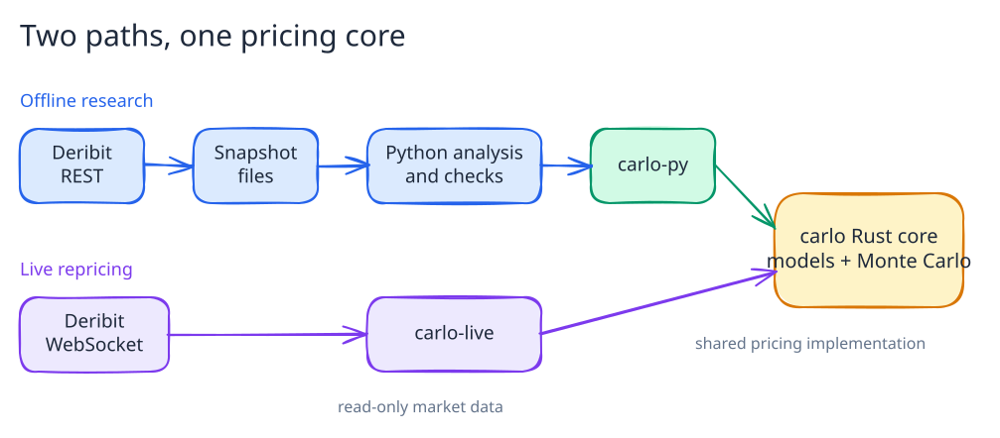

# carlo

**A Rust and Python lab for pricing and risk-testing Bitcoin options with Monte Carlo simulation.**

Take one European BTC option and price it four ways: Black-76, NumPy, Numba and Rust.
Then compare the answers and the time each one takes. The project also prices
path-dependent options, computes Greeks and estimates one-day risk for a sample book.
It does not place trades.

**A few useful guarantees:**

- Invalid numerical inputs return an error instead of silently producing `NaN`.
- A fixed seed produces bit-identical sequential and parallel Rust results.
- Only `fetch` and `live` contact Deribit, using its public, read-only market-data APIs.
- Benchmarks and market comparisons state the snapshot and machine they came from.

## Repo in one minute

The offline research path and the live feed both end at the same Rust pricing core:



[Editable Excalidraw source](docs/assets/repo-in-one-minute.excalidraw)

The `carlo` crate owns the pricing models and the shared Monte Carlo engine. Python fetches
and explores the data, supplies NumPy and Numba versions to compare against, and calibrates
Heston with QuantLib. `carlo-py` connects that Python work to Rust. `carlo-live` uses the
same Rust core on public Deribit ticker updates.

The project covers:

| Question | What you get |
|---|---|
| Can simulation reproduce a known price? | GBM Monte Carlo checked against Black-76 and Deribit marks |
| What is a path-dependent option worth? | Heston pricing for knock-out and Asian options |
| How much could a book lose tomorrow? | One-day Value at Risk and expected shortfall for a sample book |
| How fast can it run? | Python/Rust benchmarks and live repricing latency |

## Quick start

You need [Rust](https://rustup.rs), [uv](https://docs.astral.sh/uv/) and
[just](https://github.com/casey/just). `uv` installs Python 3.13 and the Python packages.

```bash
just tools    # check prerequisites and create .venv
just ci       # formatting, lints, tests and Rust docs; no market data needed
```

Market-data workflows are optional and read-only:

```bash
just fetch       # download a Deribit snapshot into data/
just calibrate   # fit Heston; write data/heston.json and out/smile.png
just checks      # compare implementations against the snapshot
just bench-py    # Python vs Rust timings in out/bench.md
```

Run `just` to list every command.

## The journey

[The full journey](docs/journey.md) explains the results and lessons behind each step.

| Step | Question | Run |
|---|---|---|
| [1](docs/journey.md#1-get-real-market-data) | What do BTC options cost now? | `just fetch` |
| [2](docs/journey.md#2-price-with-the-simplest-model-in-python) | Can simulation reproduce the market? | `just checks` |
| [3](docs/journey.md#3-the-same-in-rust-then-in-parallel) | Is Rust faster, and why? | `just bench-py` |
| [4](docs/journey.md#4-a-realistic-model-fitted-to-the-market) | Why does one volatility not fit? | `just calibrate` |
| [5](docs/journey.md#5-products-only-simulation-can-price) | What about path-dependent options? | `just checks` |
| [6](docs/journey.md#6-sensitivities-and-risk-against-the-clock) | How much could the book lose tomorrow? | `just bench-py` |
| [7](docs/journey.md#7-python-and-rust-together) | Can Python keep the convenience and use Rust's speed? | `just bench-py` |
| [8](docs/journey.md#8-live-data) | How fast can live updates be repriced? | `just live --instrument BTC-29JAN27-72000-C` |

## Limits

- VaR uses a built-in sample book; it cannot import private positions.
- Default VaR shocks are assumptions, not estimates from historical data.
- There are no orders, fees, funding, interest rates or backtests.
- Heston only approximates the volatility smile. A gap between model and market is not, by
  itself, a trading signal.
- Downloaded market data is not committed because Deribit's redistribution terms are
  unchecked. The fitted `data/heston.json` parameters are included.
- CI runs `just ci` with locked dependencies. A weekly audit checks Rust and Python
  dependencies for known vulnerabilities.
- Published checks and timings come from the dated snapshot and machine described in
  [the journey](docs/journey.md#reproducing-these-numbers); results will vary elsewhere.

## More

- [Concepts in plain English](docs/concepts.md): Monte Carlo, volatility, Greeks and VaR
  without assuming options knowledge.
- [The journey](docs/journey.md): detailed results, benchmarks and lessons.
- [Reading the results](docs/reading-results.md): what each number means and how it is used.
- [Glossary](docs/glossary.md): options and Monte Carlo terms used in the project.
- Licence: MIT (`LICENSE`). It does not cover Deribit data you download.
