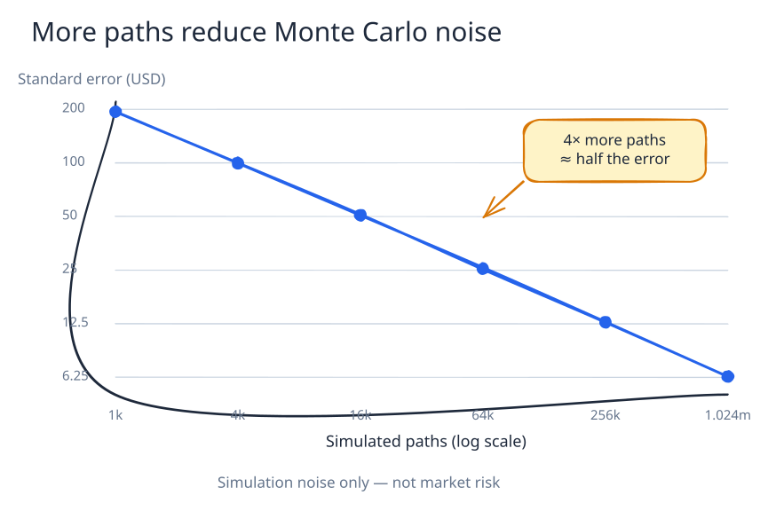
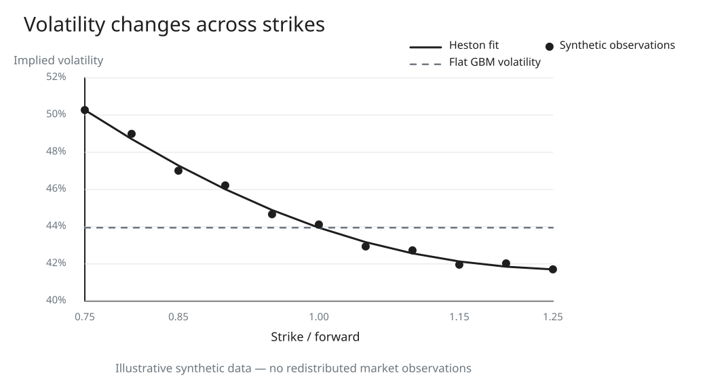
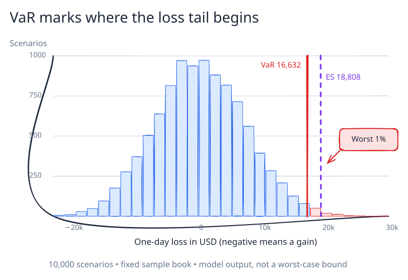

# Reading the results

Think of this page as the legend for carlo's output. It explains what the files and numbers
mean, which comparisons are useful, and where it is easy to draw the wrong conclusion. If a
term is unfamiliar, the [glossary](glossary.md) has the short version.

The numbers are model outputs from a dated market snapshot and a specific configuration.
They are useful for validation, comparison and risk analysis; they are not executable quotes
or trading signals.

## What each command leaves behind

| Command | Output | Question it answers |
|---|---|---|
| `just fetch` | `data/options_<timestamp>.parquet`, `data/history_<timestamp>.parquet` | Which options and historical prices were observed? |
| `just calibrate` | Terminal summary, `data/heston.json`, `out/smile.png` | How closely can one Heston model fit the observed volatility surface? |
| `just checks` | Validation results in the terminal | Do the simulations agree with formulas, market marks and an independent implementation? |
| `just bench-py` | Terminal table and `out/bench.md` | How do Python and Rust compare on the same calculations? |
| `just bench-rs` | Criterion benchmark report | Which parts of the Rust implementation cost time? |
| `just live ...` | Live prices and latency percentiles in the terminal | How long does repricing take after a ticker message arrives? |

`just fetch` and `just live` contact Deribit's public APIs. The other commands work from
local files after the dependencies have been installed.

## One run, in plain English

The [project journey](journey.md) was originally documented with the 14 Nov 2026 snapshot on
a 14-core Apple Silicon machine. Here are a few of those results next to the conclusion a reader
can safely draw. They are examples, not expected test values: market data and timings will change.

| Output | Example result | What it tells you |
|---|---:|---|
| NumPy GBM versus Black-76 | 93% of 322 options within 2 standard errors | The simulation noise looks consistent with the exact formula |
| Black-76 versus Deribit mark | Median gap: 0.19 USD | Units and exchange conventions line up; this is not a trading edge |
| Heston calibration | RMSE: 2.3 vol points; `xi` at its bound | The model captures the broad smile but is straining to fit it |
| Heston exotic prices | Vanilla: 3,280 USD; daily knock-out: 1,713; Asian: 1,515 | The path-dependent terms materially reduce the model price |
| One-day 99% sample-book risk (Rust) | VaR: 16,138; expected shortfall: 18,735 | The worst 1% starts near 16,138, and losses average 18,735 inside that tail |
| GBM, one million paths | NumPy: 11.1 ms; parallel Rust: 2.6 ms | Rust was about 4× faster for this calculation on this machine |
| Live repricing | Median: about 5 ms at 100,000 paths | Half of repricings finished within 5 ms after a message arrived |

The rest of this page explains why each conclusion is narrower than it may first appear.

## First, keep the units straight

| Value | Unit in this repository |
|---|---|
| Forward, strike and option price | USD in the supplied BTC examples; generally the same currency as the forward |
| Volatility | Decimal in code (`0.40`), usually displayed as a percentage (`40%`) |
| Volatility difference | Vol points: `39%` to `40%` is one vol point |
| Time to expiry | Years in pricing code; days in some reports |
| Latency | Microseconds (`µs`) or milliseconds (`ms`) |
| VaR and expected shortfall | Positive loss amounts in the book's price currency |

Deribit quotes an option mark in BTC. The data loader multiplies that mark by the expiry's
forward to produce `price_usd`, which is what the checks compare with model prices.

## Reading `price ± standard error`

A Monte Carlo price is reported as `price ± standard error`, for example
`3128.95 ± 6.38` in a benchmark run.

- **Price** is the average payoff across the simulated paths. The repository assumes a
  zero interest rate, so there is no additional discount factor.
- **Standard error** estimates the numerical uncertainty in that average.
- Roughly 95% of repeated estimates should fall within about two standard errors of the
  model's exact value when the estimator is unbiased.
- Four times as many paths should reduce the standard error by about half.

This is the important distinction: standard error measures simulation noise only. It says
nothing about a wrong model, stale inputs, calibration error, liquidity, bid/ask spread or the
future market.

So what is it good for? It tells you whether you have simulated enough paths. Keep adding paths
until the noise is small beside the price change or risk limit you care about. It also makes a
good regression check: Monte Carlo should not sit many standard errors away from an exact
formula.



*A fixed GBM example. The straight reference line is the expected inverse-square-root rate.*

## What `just checks` is telling you

### Within two standard errors

The GBM and Heston checks count how many simulated prices fall within two standard errors of a
reference price. You expect roughly 95%. If the result is much lower, look for biased time steps,
a unit mismatch or a bug.

The Heston report also prints a mean `z` score:

```text
z = (Monte Carlo price - reference price) / standard error
```

If the mean stays clearly positive or negative, the errors are leaning in one direction. That is
a sign of discretisation bias, not ordinary simulation noise. The Euler/QE comparison answers a
practical question: how much speed can you gain before the time steps distort the price?

### Black-76 versus the Deribit mark

The median and maximum gaps are plumbing checks: did we use the right units, conventions and
fields? They do not uncover a cheap or expensive option. Deribit's mark is derived from its
implied volatility, and Black-76 is given that same volatility. A close match means the code
reproduced the exchange convention.

### Realised versus implied volatility

- **Realised volatility** is calculated from the previous year of daily BTC closes.
- **Implied volatility** is backed out of a current option price and is forward-looking.

The comparison is useful context for volatility risk, but it is not a trade by itself. The two
numbers look at different periods. A real decision also depends on the term structure, smile,
hedging and transaction costs, and how the market moves along the way.

## Heston calibration

`just calibrate` fits one parameter set to options with at least 30 days to expiry.
`out/smile.png` plots market implied volatility as points, the Heston fit as a line and a flat
GBM volatility as a dotted reference.



*This teaching chart is synthetic. It shows the shape without redistributing Deribit market data.*

`data/heston.json` contains:

| Field | Meaning | What to watch |
|---|---|---|
| `v0` | Variance at the start of the simulation | Its square root is the starting volatility |
| `theta` | Long-run variance | Its square root is the model's long-run volatility level |
| `kappa` | Speed at which variance returns toward `theta` | Large values mean faster mean reversion |
| `xi` | Volatility of variance, often called vol of vol | Large values make the volatility path less stable |
| `rho` | Correlation between price and variance moves | Negative values create the downside skew common in crypto options |
| `rmse_vol_points` | Typical gap between fitted and market implied volatility | Lower is better, but zero can indicate overfitting |
| `feller` | Whether the fitted parameters satisfy the Feller condition | Failure makes near-zero variance more important for the simulation scheme |
| `at_bound` | Parameters stopped by the calibration limits | A populated list means the model is straining to fit the surface |

The fitted parameters give you one consistent model for products that have no market quote.
They are not facts about the world, and they can jump between snapshots. If this fit were feeding
a real pricing process, you would track parameter stability, fit error and hedge performance,
and stop when the fit became poor.

## Exotic prices and Greeks

The checks compare a vanilla call, an Asian call and a knock-out call under the same Heston
parameters. The relationships are as important as the absolute prices:

- In the checked scenario, the Asian call is cheaper because its payoff uses the average
  price rather than the final price.
- An up-and-out call is cheaper because it becomes worthless after touching its barrier.
- More frequent barrier monitoring finds more touches and therefore lowers the knock-out price.

These prices are a starting point for a quote or a scenario, not the finished number. A real
quote also needs a bid/ask spread, hedge cost, liquidity, fees, capital usage and a model-risk
reserve.

Greeks describe small local changes around the current inputs:

| Greek | Number means | Typical use |
|---|---|---|
| Delta | Price change for a one-unit move in the forward | Size a first-order forward hedge |
| Gamma | Change in delta for a one-unit move in the forward | Estimate how quickly the hedge will change |
| Vega | Price change for a one-vol-point move | Measure and hedge implied-volatility exposure |
| Theta | Price change when one calendar day passes | Estimate daily time decay with other inputs fixed |

Greeks are local approximations, not worst-case losses. Large market moves, barrier events and
changes in the volatility surface require full repricing or stress scenarios.

## VaR and expected shortfall

The benchmark reports `base_value`, Value at Risk (`var`) and expected shortfall. Losses are
positive numbers. If the Rust benchmark reports `VaR 16,138, ES 18,735` at 99% confidence:

- `16,138` is the modelled one-day loss threshold exceeded in roughly 1% of scenarios.
- `18,735` is the average loss within that worst 1%.
- Expected shortfall should be at least as large as VaR.



*This chart uses the NumPy baseline, which gives VaR 16,632 and expected shortfall 18,808
from different random draws. Red marks the worst 1%.*

A risk manager might use these measures to set limits, allocate capital or compare two books.
They do not predict the worst possible loss. Carlo uses a built-in sample book and assumed
price/volatility shocks. Before using the result on a real book, you would need the real
positions, calibrated shocks, historical backtests, stress tests and liquidity adjustments.

With 10,000 scenarios, the worst 1% contains about 100 observations. More scenarios improve
tail stability, while more nested paths reduce noise in each path-dependent revaluation.

## Timings and live latency

Timing numbers travel badly between machines, so `out/bench.md` records the hardware and library
versions. Compare implementations within the same run and problem size. The `Result` column is
there to catch a fast but wrong implementation; speed on its own proves nothing.

For the book benchmark, `sum` is an aggregate consistency check across the option prices, not
the value of the sample VaR book or a tradable portfolio.

The live program reports `p50`, `p90`, `p99` and maximum latency:

- `p50`: half of repricings were faster and half slower.
- `p90`: 90% completed at or below this time.
- `p99`: only about 1% were slower.
- `max`: the slowest observed update; sensitive to short runs and operating-system pauses.

Latency starts when the WebSocket message is received and ends after repricing. It excludes
exchange publication time, network transit before receipt, order construction and execution.
The percentiles can guide capacity and latency budgets, but they are not end-to-end trading
latency.

## Before you trust a number

1. Identify the snapshot, model, path count, time steps, seed and machine.
2. Check whether the number is a price, numerical error, model-fit error, risk measure or time.
3. Make simulation error small enough for the decision being made.
4. Inspect calibration RMSE, parameters at bounds and sensitivity to the simulation scheme.
5. Replace the sample book and assumed shocks before drawing conclusions about a real portfolio.
6. Add spreads, fees, liquidity, funding, stress scenarios and model-risk reserves where relevant.
7. Re-run across snapshots and configurations; one deterministic run is not evidence of stability.

Regenerate all three charts with `just docs-assets`. They use fixed offline inputs and do not
read downloaded market snapshots.
